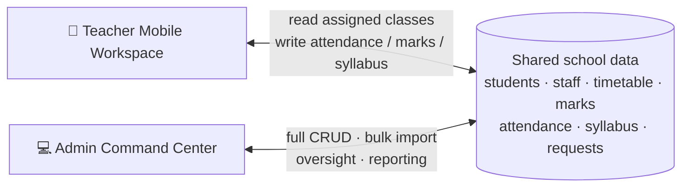

# 01 — Product Overview

## 1. What the product is

Nawaz School is a school-management system built around two distinct user experiences that share one institutional dataset:

| Surface | Primary user | Primary device | Optimisation goal |
| :--- | :--- | :--- | :--- |
| **Teacher Mobile Workspace** | Classroom teacher | Phone | Fast, low-friction daily tasks: roll-call, marks, syllabus ticks, notices, private requests. |
| **Admin Command Center** | Principal / owner / ops manager | Windows desktop / wide browser | School-wide oversight, bulk data, permissions, analytics, audit, and communications. |

The original product notes describe a Flutter Windows admin app and a Flutter mobile teacher app against a Supabase/PostgreSQL backend. The **actual** repository is a single Flutter app with a runtime role switch and an in-memory demo database, plus optional Firebase/Firestore service code.

---

## 2. The two products in one screen each

### Teacher workspace

> “I have 40 seconds before the bell. Show me my class, let me mark who is absent, and let me get on with teaching.”

The teacher experience is a pastel Aurora UI with a fixed app header, a bottom navigation bar, and a quick-action sheet. The main areas are Home, Attendance, Timetable, Marks, Syllabus, Reports, and RMS. The teacher's identity is hardcoded as **Prof. Sarah Nawaz** (`tch_sarah_01`) in the demo.

### Admin console

> “I need to see the whole school, import the term's data once, fix mistakes quickly, and know who is behind.”

The admin experience is a dense forest-green/slate Bento UI with a fixed sidebar, a command bar, and a large data canvas. It covers ingestion, live grids, staff/RBAC, class-incharge permissions, subject/exam assignment, attendance oversight, leave/maintenance desks, a confidential vault, a teacher-screen simulator, and an executive report page.

---

## 3. Target users and jobs to be done

| Actor | Role in the system | Jobs to be done |
| :--- | :--- | :--- |
| **Principal / Owner** | SuperAdmin | See school KPIs; import rosters/timetables/marks; assign staff; approve leave; resolve maintenance; read confidential notes; audit a teacher's view; export a board report. |
| **Vice-Principal / Academic Head** | SubAdmin (intended) | Monitor syllabus pace, marks, and attendance; manage subject/exam assignment; cannot alter staff privileges or open the vault. |
| **Classroom teacher** | TeacherApp | Take roll-call for assigned/incharge classes; enter marks after an exam unlocks; tick syllabus topics; view timetable; share a student slip; raise a private request; read notices. |
| **Operator / IT / Exam cell** | SubAdmin | Import data, manage timetables/exams, operate the live grids. |
| **Non-software staff** | NoAccess (electrician, driver, support) | Appear in the staff directory and staff-attendance roll-call, but never log in. |
| **Parent** | Not a user in the current app | Receives a WhatsApp-shared progress slip from the teacher; no parent portal exists. |
| **Student** | Not a user in the current app | Appears as a roster/data record only. |

---

## 4. Product capability map

### 4.1 Teacher capabilities

| Capability | What it does | Current state |
| :--- | :--- | :--- |
| **Today dashboard** | Attendance hero, urgent notice, at-risk alert, module cards. | 🟡 Partly data-driven; several cards and counts hardcoded. |
| **Zero-friction roll-call** | Default all present; cycle Present → Absent → Late → Excused; reason presets; save to daily records and monthly summary. | ✅ In-memory flow works; cloud is best-effort. |
| **Period handover** | Select a period; roll-call can be taken by the teacher on duty. | 🟡 Period list is hardcoded; selection is not enforced. |
| **Timetable** | Today/5-day view, teacher-scoped or whole-school, filter by labs/active/upcoming. | 🟡 Live period is hardcoded; scope matching partly broken. |
| **Marks entry** | Exams unlock after their end time; enter scores; see live average/pass/fail; batch commit and lock. | ✅ Core flow works in memory. |
| **Marks ledger** | All tests, filter by teacher CAs vs principal exams, risk alert. | ✅ Data-driven from test records. |
| **Syllabus tracker** | Teacher-assigned subjects, chapter list, tap to cycle status, completion percentage. | ✅ In-memory; JSON chapter model. |
| **Student report slip** | Per-student card with attendance, recent scores, remarks, risk flag. | ✅ Rendered; PDF/WhatsApp is simulated. |
| **RMS request desk** | Leave, maintenance, gear, confidential request; auto-tagging; status view. | ✅ In-memory create/list. |
| **Notices** | Urgent/pinned + chronological feed, filters, image lightbox. | ✅ In-memory + optional Firestore stream. |
| **Faculty profile** | Contact info, assigned classes, preference toggles, role switch. | 🟡 Mostly static; toggles are cosmetic. |

### 4.2 Admin capabilities

| Capability | What it does | Current state |
| :--- | :--- | :--- |
| **Admin authentication** | Email + password form, RBAC clearance check. | 🟡 Password is never checked; demo presets pre-filled. |
| **School dashboard** | KPI cards, attendance matrix, syllabus velocity, risk radar, quick RMS actions. | 🟡 Some live counts; several values hardcoded. |
| **Bulk Excel ingestion** | Download a 14-sheet master workbook; upload/validate/commit; single-sheet CSV staging. | ✅ In-memory commit with validation; schema/code drift. |
| **Live spreadsheet grid** | 14 datasets, filters, search, add row, delete, inline editing. | 🟡 Add/delete work in memory; student inline “Save” does not persist. |
| **Staff & RBAC hub** | Add/edit/delete staff, elevate access, activate/deactivate, filters. | ✅ In-memory CRUD. |
| **Class-incharge desk** | Default Period-1 teacher, override attendance rights per section. | ✅ In-memory override. |
| **Subject assignment** | Assign a teacher to a subject in a section. | ✅ In-memory; chapter data seeded. |
| **Exam assignment** | Create CA/mid/end exam, assign to teacher, set date/max marks. | ✅ In-memory; sync to teacher stream. |
| **Student attendance hub** | Live roll-call, monthly day matrix, student inspector, parent contact. | ✅ In-memory, rich UI. |
| **Leave desk** | Filter RMS leave tickets, approve/reject. | ✅ In-memory. |
| **Maintenance log** | View repair tickets, resolve/assign. | ✅ In-memory. |
| **Principal vault** | Confidential notes behind a PIN screen. | 🟡 PIN is not validated. |
| **Teacher audit viewer** | Embedded phone wireframe showing the real teacher screens. | ✅ Renders live widgets; identity is not really impersonated. |
| **Executive PDF** | “Compile” a board report. | 🔴 Static preview + snackbar; no PDF. |
| **Announcements hub** | Compose, target, prioritise, pin, attach image, publish, delete. | ✅ In-memory + optional Firestore. |
| **Profile & security** | RBAC matrix, session info, password rotation, sign out. | 🟡 Mostly static; password change simulated. |

---

## 5. End-to-end journeys

### 5.1 Teacher morning roll-call

1. Splash screen (1 s) → main navigation.
2. Teacher taps **Attendance** (hero card or bottom quick action).
3. Selects date, class section, session and period.
4. Roster is pre-filled Present.
5. Teacher taps absent/late students; a reason sheet opens; chooses a preset or types a note.
6. Presses **Sync Attendance**.
7. `AttendanceService` attempts a Firestore write to `attendance_records/{section}_{date}`, then updates the in-memory roster and daily attendance records.
8. The admin dashboard's attendance matrix reflects the in-memory state.

### 5.2 Admin term setup

1. Admin signs in (any permitted email; password ignored).
2. Opens **Multi-Excel Center**.
3. Downloads `nawaz_school_master_database.xlsx` (14 tabs generated by the app).
4. Fills the workbook and uploads it.
5. App validates each sheet's headers, shows a health card per tab, parses rows.
6. Admin commits; `ExcelMasterService.commitMasterWorkbook` writes to the in-memory `MockDatabase`.
7. Teacher app now sees the new roster/timetable/marks/syllabus in its next rebuild.

### 5.3 Teacher marks entry after an exam

1. Admin creates an exam in **Exam Assignment Hub** and assigns a teacher.
2. Exam sits in `exam_schedules` with status `Upcoming`.
3. When device time passes the exam's date + end time, `effectiveStatus` becomes `Open`.
4. Teacher opens **Marks → Post-Exam Entry Terminal**, sees “Enter Marks (Exam Concluded)”.
5. Enters scores; app shows live class average and flags scores below 35%.
6. **Batch Commit & Lock** builds one `TestRecordModel` per student, attempts a Firestore batch, and syncs to the in-memory test records.
7. Exam becomes `Submitted`; the admin analytics/matrix can use the records.

### 5.4 Teacher raises a leave request

1. Teacher opens **RMS Desk → New Request → Leave**.
2. Fills leave type, duration, reason.
3. `MockDatabase.submitRmsTicket` classifies the text (leave keywords) and inserts a ticket.
4. Admin sees it in **Leave Desk**, approves/rejects with a principal note.
5. Teacher sees the updated status in the RMS feed.

### 5.5 Admin audits a teacher

1. Admin opens **Teacher Audit Viewer**.
2. Selects a faculty member and a screen chip.
3. The right pane renders the real `DashboardScreen`, `AttendanceScreen`, `TimetableScreen`, `MarksScreen`, `SyllabusScreen`, `ReportsScreen`, or `RmsScreen` inside a phone chassis.
4. The preview uses the same singleton database, so it reflects current data — but not that teacher's actual scoped identity.

---

## 6. Product principles implied by the current app

1. **Default-to-present attendance** — the teacher only taps exceptions.
2. **Auto-unlock assessments** — no manual “open marks” step after an exam ends.
3. **Private-by-default staff communication** — RMS bypasses public chat.
4. **Bulk data over cell-by-cell entry** — Excel is the primary admin input.
5. **Instant feedback** — in-memory state makes every tap feel live.
6. **Dual-lens analytics** — by teacher and by class (intended; the admin UI currently shows hardcoded rows).
7. **Phone-first teacher ergonomics** — large pills, bottom sheets, short flows.
8. **Desktop density for admin** — sidebar, tables, multi-column cards.

---

## 7. Current state vs intended state

| Area | Original intent | Actual implementation |
| :--- | :--- | :--- |
| Deployment | Separate Windows admin app + mobile teacher app | One Flutter app, runtime role switch, web-only platform folder |
| Backend | Supabase/PostgreSQL, realtime | In-memory `MockDatabase`; optional Firestore helpers; no configured project |
| Auth | Email activation, passwords, role scoping | Admin: static email check only. Teacher: no login. |
| Data | Server persisted, RLS-scoped | RAM; reset on reload. Some best-effort Firestore writes. |
| Reports | PDF compiled and shared | Static preview; no PDF library |
| WhatsApp | Native share intent with PDF | Snackbar simulation |
| Notifications | FCM push | `print` statement only |
| Excel | Strict 14-table master workbook | 8/9-sheet legacy files in repo; 14-sheet generator in code |
| Offline | Offline-first cache + sync | Cosmetic toggle only |
| Multi-admin | SuperAdmin/SubAdmin granular | UI gating only; not enforced server-side |

---

## 8. What “simpler in a new stack” should mean

The rewrite should keep the **product behaviour** and remove the **accidental complexity**:

- One canonical schema instead of three Excel formats.
- One model layer instead of duplicate `core_shared` and `lib` classes.
- One real persistence layer instead of RAM + optional Firestore.
- One permission model enforced by the server, not by hiding sidebar items.
- Separate frontends for phone and desktop, sharing generated API types.
- Real integrations for PDF, WhatsApp/share, and notifications, or explicit removal.
- A test suite that tests the canonical models, not stale copies.

See [10 — Rewrite Guide](10-rewrite-guide.md) for the concrete target architecture and migration sequence.
