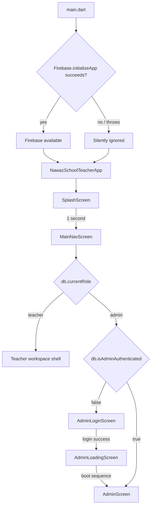
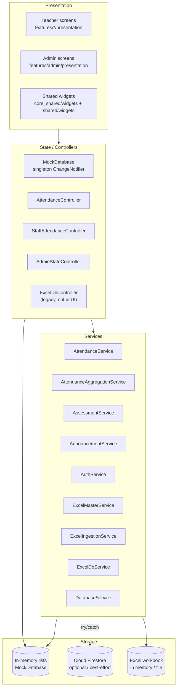

# 02 — Architecture

## 1. Repository structure

```text
nawaz school/
├── lib/                              # Flutter application package: nawaz_school
│   ├── main.dart                     # Firebase init attempt + teacher app root
│   ├── core/                         # Re-export shims to package:core_shared
│   │   ├── data/mock_database.dart   # export only
│   │   ├── models/...                # export only
│   │   ├── services/...              # export only
│   │   ├── theme/...                 # export only
│   │   └── utils/...                 # export only
│   ├── models/                       # ⚠️ Legacy duplicate models (not canonical)
│   ├── services/                     # Legacy Excel services + re-export
│   ├── controllers/                  # Attendance, staff-attendance, Excel-workbook controllers
│   ├── features/
│   │   ├── splash/
│   │   ├── navigation/               # Teacher shell + runtime role switch
│   │   ├── dashboard/                # Teacher home
│   │   ├── attendance/               # Teacher roll-call
│   │   ├── timetable/
│   │   ├── marks/
│   │   ├── syllabus/
│   │   ├── reports/
│   │   ├── rms/
│   │   ├── announcements/
│   │   ├── profile/
│   │   └── admin/presentation/       # Admin console, screens, widgets, controller
│   ├── shared/widgets/               # Re-export shims + teacher app header
│   └── views/                        # Legacy admin dashboard + attendance hub
├── core_shared/                      # Local package: core_shared
│   └── lib/
│       ├── core_shared.dart          # Barrel export
│       ├── models/                   # ✅ Canonical models used by the running app
│       ├── services/                 # Mock DB + Firestore services
│       ├── theme/                    # AppColors / AppTheme
│       ├── utils/                    # cross-platform file import/export
│       └── widgets/                  # Aurora, PercentRing, cards, skeleton
├── test/                             # Flutter tests (mostly target legacy models)
├── tool/                             # Excel generator scripts (one has a syntax error)
├── web/                              # Only configured platform target
├── firestore.rules
├── firestore.indexes.json
├── admin.md
├── school_app_system_logic.md
└── system_features_and_excel_architecture.md
```

### 1.1 The two model layers

The running app **imports canonical models through `core_shared`**:

```dart
// lib/core/models/student.dart
export 'package:core_shared/core_shared.dart';
```

Screens import `../../../core/models/...`, which resolves to the `core_shared` classes.

However, `lib/models/` and `lib/services/` contain a second, older copy of the same domain, including a different `ExamScheduleModel` with `grade`, `date`, `time`, `room`, and `status` fields. The legacy `ExcelDbService`, `ExcelDbController`, and tests use this older copy. Because `package:core_shared/core_shared.dart` also exports the newer `ExamScheduleModel`, any file that imports both gets an ambiguous or incompatible type.

**This is a structural defect, not just duplication.** It has already broken `test/excel_db_service_test.dart` compilation.

For the rewrite: delete one layer. Use a single generated/shared domain package and make all apps/imports point to it.

---

## 2. Application boot and role routing



### 2.1 Important boot facts

- `Firebase.initializeApp()` is called without platform options and wrapped in `try/catch (_) {}`. If Firebase is not configured, the app silently continues in demo mode.
- `MockDatabase._isAdminAuthenticated` starts as **`true`**. Therefore, switching to admin from the UI goes straight to the console; `AdminLoginScreen` only appears after `logoutAdmin()`.
- The teacher app has **no login screen at all**. `SplashScreen` goes directly to the teacher workspace.
- Both apps share one `MaterialApp` and one widget tree. The admin surface is not a separate route tree or build target.

---

## 3. Runtime layers



### 3.1 State management

There is no Provider/Riverpod/Bloc package. State is managed by:

- A **singleton `MockDatabase extends ChangeNotifier`**, constructed once and accessed via `MockDatabase()`.
- `AnimatedBuilder(animation: db, ...)` around almost every screen to rebuild on `notifyListeners()`.
- Local `setState()` for filters, selected rows, and modal inputs.
- Screen-local controllers:
  - `AttendanceController` wraps the mock DB for the admin Student Attendance Hub.
  - `StaffAttendanceController` wraps staff check-in/out.
  - `AdminStateController` holds admin filters, dataset blueprints, staged import state, and workbook generation.
  - `ExcelDbController` wraps the legacy in-memory workbook service; it is not used by the running UI.

**Consequence:** every screen is coupled to the global singleton. There is no dependency injection, no repository boundary, and no way to run teacher and admin sessions with different data scopes.

### 3.2 Source of truth by feature

| Feature | UI reads from | UI writes to | Cloud attempt? |
| :--- | :--- | :--- | :--- |
| Students / roster | `db.students` | `db.addNewStudent`, `db.deleteStudent`, ingest | ❌ |
| Teacher timetable | `db.timetable` | Admin grid add/delete | ❌ |
| Teacher attendance | `db.studentsInSelectedClass`, local map | `AttendanceService.submitDailyAttendance` + `db.batchSaveDailyAttendance` | ✅ best-effort `attendance_records` |
| Admin attendance hub | `db.loadDailyAttendance`, `db.recomputeMonthlySummary` | `db.batchSaveDailyAttendance` | ❌ |
| Marks / exams | `db.testRecords`, `db.examSchedules` | `AssessmentService.submitExamMarks` + `db` | ✅ best-effort batch |
| Syllabus | `db.getSubjects()` | `db.updateSubjectChapters` | ❌ |
| RMS tickets | `db.rmsTickets` | `db.submitRmsTicket`, `db.updateRmsTicketStatus` | ❌ |
| Announcements | `db.announcements` + optional `AnnouncementService` stream | `AnnouncementService.publish` + `db` | ✅ best-effort |
| Staff directory | `db.staffList` | `db.addNewStaffMember`, update/delete/elevate | ❌ |
| Class incharge | `db.classIncharges` | `db.setClassInchargeOverride` | ❌ |
| Admin settings/profile | `db.adminName/email/role` | `db.loginAdmin/logoutAdmin` | ❌ |

`DatabaseService`, `ExcelIngestionService`, `AttendanceAggregationService`, `ExcelDbService`, and `ExcelDbController` contain Firestore/Excel logic but are **not wired into the running UI**. They are effectively reference implementations or dead code.

---

## 4. Navigation architecture

### 4.1 Teacher navigation

The teacher shell is a `Scaffold` with:

- `TeacherAppHeader` at the top.
- An `IndexedStack` of 7 screens.
- A custom bottom bar with 5 items and a central add button.

`IndexedStack` indices:

| Index | Screen | Reachable from bottom bar? |
| :---: | :--- | :--- |
| 0 | `DashboardScreen` | ✅ Home |
| 1 | `AttendanceScreen` | Via quick action / dashboard / header flow |
| 2 | `TimetableScreen` | ✅ Timetable |
| 3 | `MarksScreen` | Via quick action / dashboard |
| 4 | `SyllabusScreen` | ✅ Syllabus |
| 5 | `ReportsScreen` | Via quick action / dashboard |
| 6 | `RmsScreen` | ✅ RMS Desk |

The central `+` opens a bottom sheet with:

- Take Roll Call Attendance → index 1
- Log Assessment Marks → index 3
- Dispatch WhatsApp Report Card → index 5
- Switch to SaaS Admin Console → role change

### 4.2 Admin navigation

`AdminScreen` uses a single `_activeNavIndex` integer and a `switch` to render the active module. There is no router package.

| Index | Module | Widget |
| :---: | :--- | :--- |
| 0 | Dashboard Overview | `_buildBentoDashboard` |
| 1 | Multi-Excel Center | `MultiExcelCenterScreen` |
| 2 | Analytical Trends | `_buildAnalyticalTrendsView` |
| 3 | Leave Desk | `_buildLeaveManagementDesk` |
| 4 | Maintenance Logs | `_buildMaintenanceOperationsTracker` |
| 5 | Principal Vault | `_buildPrincipalSecureVault` |
| 6 | Live Spreadsheet Grid | `LiveSpreadsheetGridScreen` |
| 7 | Teacher Audit Viewer | `_buildTeacherSystemImpersonationAuditTool` |
| 8 | Executive PDF | `_buildExecutiveProgressReportCompiler` |
| 9 | Staff & Access Hub | `StaffAccessHubScreen` (SuperAdmin only) |
| 10 | Announcements Hub | `AdminAnnouncementScreen` |
| 11 | Profile & Security | `AdminProfileScreen` |
| 12 | Student Attendance Hub | `StudentAttendanceHubScreen` |
| 13 | Attendance Access Desk | `AttendanceAccessHubScreen` |
| 14 | Subject Assignments | `SubjectAssignmentHubScreen` |
| 15 | Exam Assignment Hub | `ExamAssignmentHubScreen` |

The sidebar hides modules 5 and 9 for SubAdmin; `_buildActiveView` also guards them with a “SuperAdmin Clearance Required” screen. This is **client-side visibility only**.

---

## 5. Data and service architecture

### 5.1 `MockDatabase` — the de facto database

`core_shared/lib/services/mock_database.dart` (~3,175 lines) is the heart of the current app. It is a singleton with:

- Demo seed data for faculty, students, timetable, syllabus, tests, exams, staff, announcements, class incharges, subjects, staff attendance, and daily attendance.
- `UserRole` (teacher/admin) and admin session fields.
- Lists and getters for every entity.
- Teacher-scoped getters (`teacherTimetable`, `teacherSyllabus`, `studentsInSelectedClass`, `classes`).
- CRUD methods for students, timetable, syllabus, tests, exams, RMS, staff, announcements, class incharge, subjects, attendance summaries, and daily attendance.
- Excel/CSV ingestion methods with validation.
- Export-to-CSV methods.
- `notifyListeners()` after every mutation.

This class currently does the job of **database + repository + auth session + authorization scope + demo fixture + import engine**.

### 5.2 Firestore services

| Service | Responsibility | Used by UI? |
| :--- | :--- | :---: |
| `DatabaseService` | Reactive Firestore queries for students/classes/teachers/results/announcements/exams/staff, atomic marks batch. | ❌ |
| `AttendanceService` | Daily attendance submission, realtime stats, mock fallback. | ✅ Attendance screen + admin attendance widget |
| `AttendanceAggregationService` | Cumulative attendance counters and master rows. | ❌ |
| `AssessmentService` | Teacher exam stream, auto-unlock, batch marks submission, result matrix. | ✅ Marks screen |
| `AnnouncementService` | Announcement streams, publish, pin, delete, image data URI, fake push. | ✅ Admin + teacher notices |
| `AuthService` | Static/async RBAC checks against staff directory. | ✅ Admin login only |
| `ExcelIngestionService` | Teachers/classes/students/marks Excel parsing + Firestore batch. | ❌ |
| `ExcelMasterService` | 14-sheet workbook export, validation, and commit into `MockDatabase`. | ✅ Admin ingestion |
| `ExcelDbService` | In-memory workbook CRUD for 11/12 sheets. | ❌ (tests/legacy controller) |
| `ExcelAttendanceService` | Daily/monthly attendance sheet logic. | ❌ (tests) |

### 5.3 Firebase configuration

- Dependencies: `firebase_core ^3.6.0`, `cloud_firestore ^5.4.4`.
- `main.dart` calls `Firebase.initializeApp()` with no `FirebaseOptions` and swallows errors.
- No `google-services.json`, `GoogleService-Info.plist`, or `firebase_options.dart` exists.
- No Firebase Storage or Messaging dependency, despite image/FCM claims.
- `firestore.rules` and `firestore.indexes.json` exist, but the rules cover only six collections and reference `teachers.role`, while the app's RBAC model uses `staff.access_level`.

**Result:** “cloud sync” is effectively optional and unverified. In a fresh environment the app runs in demo mode.

---

## 6. Platform and build targets

The repository contains **only `web/`** as a platform folder.

- `flutter run -d chrome` is possible if Chrome is available.
- `flutter build windows` will fail without a `windows/` folder.
- `flutter build apk` will fail without an `android/` folder.
- `flutter build ios` will fail without an `ios/` folder.

The UI includes desktop-width layouts (admin) and phone-width layouts (teacher) but no platform-specific code or adaptive router. The web manifest is portrait-primary, which conflicts with the desktop admin intent.

For the rewrite: create explicit targets and decide whether the admin is a web app, a Windows desktop app, or both.

---

## 7. Cross-cutting concerns

### 7.1 Theming

Two separate design systems:

- **Teacher:** `AppColors` / `AppTheme` in `core_shared/lib/theme/`: Aurora pastel mesh, purple primary, white rounded cards, soft shadows, Roboto.
- **Admin:** `BentoTheme` in `lib/features/admin/presentation/widgets/bento_theme.dart`: slate background, forest-green primary, mint accents, compact radii (4–10 px), dense tables.

Shared primitives: `AuroraBackground`, `PercentRing`, `StatMetricCard`, `QuickActionCard`, `SkeletonLoader`, `TeacherAppHeader`.

The visual split is a product strength and should be preserved.

### 7.2 File import/export

Conditional imports provide web and IO implementations:

- `file_importer.dart` → `file_importer_web.dart` / `file_importer_io.dart` / stub.
- `file_exporter.dart` → `file_exporter_web.dart` / `file_exporter_io.dart` / stub.

`FileImporter.pickAndReadFile()` returns a `PickedFile` with `fileName`, `content` (for CSV/text), `bytes` (for `.xlsx`), and `isExcel`. `FileExporter.saveAndDownloadBytes` triggers a browser download or writes to disk.

The IO exporter uses a Windows path such as `C:\SchoolManagement\Exports\...`; the snackbars repeat that path, but the folder is not guaranteed to exist.

### 7.3 Error handling

Most cloud writes are wrapped in `try { ... } catch (_) {}`. Failures are invisible to the user. Several screens show a success snackbar **before** any persistence is verified (or without persisting at all). This makes the demo feel reliable while hiding real failures.

### 7.4 Testing

- 6 test files plus a wrapper.
- Tests target `package:nawaz_school/models/...` and `package:nawaz_school/services/...` (legacy layer).
- The running app targets `core_shared`.
- `flutter test` currently gives **22 passed, 5 failed**; the failures are compile/type breaks from the duplicate models.
- No widget tests, no integration tests, no Firestore emulator tests.

### 7.5 Dead / legacy code

| Path | Status |
| :--- | :--- |
| `lib/features/home/presentation/home_screen.dart` | Unused; imports broken; references missing `QuickActionCard`/`AppColors`. |
| `lib/views/dashboard/admin_dashboard_screen.dart` + widgets | Unused; old admin dashboard; has compile errors. |
| `lib/controllers/excel_db_controller.dart` | Unused by UI; includes mismatched exam types. |
| `lib/services/excel_db_service.dart`, `excel_attendance_service.dart` | Unused by UI; test-only. |
| `lib/models/...` | Stale duplicate models. |
| `admin_screen.dart` legacy `_buildMultiExcelCenter`, `_buildInAppSpreadsheetGridEditor` | Superseded by dedicated screens; not routed. |
| `tool/generate_master_excel_2.dart` | Syntax error (missing `}`); not part of app build. |

---

## 8. Architectural verdict

**Strengths**

- Clear visual separation between teacher and admin experiences.
- Rich, domain-specific screens with sensible workflows.
- A comprehensive set of models and business rules already thought through.
- Cross-platform file import/export abstractions.
- Extensive demo data that makes the product understandable immediately.

**Structural problems**

1. One app, two products, one global mutable singleton.
2. Three competing data definitions (canonical models, legacy models, Excel schemas).
3. Fake persistence and silent failures.
4. Client-only authorization.
5. No router, no DI, no repository boundary.
6. Only a web target despite desktop/mobile claims.
7. Large dead-code surface that still breaks analysis/tests.

**Rewrite direction**

Adopt a modular monolith or small service-oriented backend, one shared schema package, two separate clients, server-enforced RBAC, and real persistence. Keep the workflows and visual identity; replace the plumbing.
