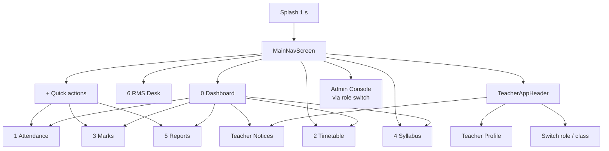
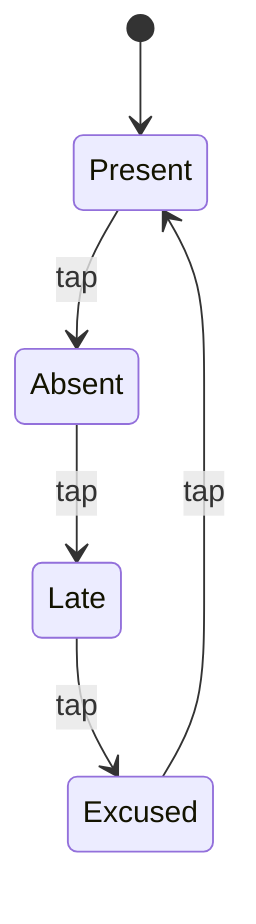

# 03 — Teacher Mobile Workspace

> **Target user:** classroom teacher on a phone.
> **Demo identity:** Prof. Sarah Nawaz · `tch_sarah_01` · `s.nawaz@school.edu` · Science & Mathematics Dept.
> **Entry point:** `lib/main.dart` → `SplashScreen` → `MainNavScreen`.
> **Shell:** `lib/features/navigation/presentation/main_nav_screen.dart`.

---

## 1. Navigation map



### 1.1 Bottom navigation reality

The bottom bar shows five controls (Home, Timetable, centre `+`, Syllabus, RMS Desk). Attendance, Marks, and Reports are **not** bottom-bar destinations; they are reached from dashboard cards, the quick-action sheet, or the attendance hero button.

---

## 2. App shell

### 2.1 `MainNavScreen`

Responsibilities:

- Owns the current tab index and optional skeleton state.
- Listens to `MockDatabase` via `AnimatedBuilder`.
- Chooses teacher vs admin tree based on `db.isAdmin`.
- Builds the teacher `IndexedStack`, header, and custom bottom bar.
- Hosts the quick-action bottom sheet.

Key behaviours:

| Behaviour | Detail |
| :--- | :--- |
| Skeleton | When launched from splash, shows `DashboardSkeleton` for 900 ms. |
| Role switch | “Switch to SaaS Admin Console” sets `UserRole.admin`; if the admin session is authenticated (default), the console opens immediately. |
| Class selection | The header class pill opens a sheet listing `db.classes`, which is derived from the teacher's timetable. |
| Profile sheet | Shows teacher profile, teacher/admin options, and the option to open the full profile screen. |
| State | No persistence; tab index resets on app restart. |

### 2.2 `TeacherAppHeader`

File: `lib/shared/widgets/app_header.dart`

- Avatar and greeting (`Hello!` + teacher name).
- Role badge (`TEACHER`).
- Active class pill (`Class 10-A` by default) with dropdown sheet.
- Notice bell with a red dot if any announcement requires an alert header.
- Profile icon that opens the role/profile sheet.
- In admin mode, a “Teacher Mode” button and admin identity.

### 2.3 Theme

- Pastel Aurora background (`AuroraBackground`): mint, pink, lavender, peach radial blobs.
- Primary purple `#5E43F3`.
- White cards with 20–28 px radii and soft purple-tinted shadows.
- Roboto; dense mobile typography.

---

## 3. Screen-by-screen specification

### 3.1 Splash — `features/splash/presentation/splash_screen.dart`

**Purpose:** brand moment and transition.

- Displays `logo.jpeg` in a white circle, “NAWAZ SCHOOL”, “Teacher Mobile Workspace”, and “Verified Faculty Portal”.
- 800 ms scale/fade animation; 1 s timer; fade-replaces to `MainNavScreen(startWithSkeleton: true)`.
- No auth check, no data loading, no error state.

**Status:** ✅ Implemented; branding-only.

---

### 3.2 Dashboard — `features/dashboard/presentation/dashboard_screen.dart`

**Purpose:** daily landing page that answers “what do I need to do now?”

**Data-driven parts**

| Element | Source |
| :--- | :--- |
| Urgent notice banner | `db.announcements.where(requiresAlertHeader)`; shows first item, tap → notices screen. |
| Attendance hero percentage | `db.studentsInSelectedClass` + `attendanceStatus`; falls back to 85% when zero. |
| At-risk alert | `db.getAtRiskStudents(db.selectedClass)`; count and tap-to-marks. |
| Attendance module card | Present count / roster count and attendance percentage. |
| Math/Physics module cards | `db.getSyllabusProgress(selectedClass, subject)`. |
| Parent WhatsApp card | Fixed 88% ring; tap → Reports. |

**Hardcoded / mock parts**

- “In Progress” strip always shows the same 3 cards:
  - Physics (Theory) · Period 2 · Room 204 · 65%
  - Physics Lab Session · Class 10-B · Lab Alpha · 20%
  - Math: Quadratic Eq. · Syllabus Milestone
- The “In Progress” badge count is always `3`; “Workspace Modules” badge always `4`.
- Several subtitle strings are fixed (“Chapter 2: Nature of Roots”, “Unit 10: Simple Harmonic Motion”).
- The hero title “Today's classes almost complete!” is static.

**Known calculation issue**

`MockDatabase.getSyllabusProgress` returns a fraction (e.g. `0.65`). The dashboard's “Math: Quadratic Eq.” in-progress card passes `mathProgress / 100.0` to its linear progress bar, producing `0.0065` (about 0.65% fill). The module card passes `mathProgress` to `PercentRing`, which treats values ≤ 1 as fractions and displays it correctly as 65%. The two cards therefore disagree. See [Known Issues](09-known-issues.md) (KI-29).

**Actions**

- “Take Attendance” → attendance tab.
- Hero, cards, and alert → their respective tabs.
- Notice banner → `TeacherNoticesScreen`.

**Status:** 🟡 Mixed; key metrics live, presentation partly hardcoded.

---

### 3.3 Attendance — `features/attendance/presentation/attendance_screen.dart`

**Purpose:** zero-friction roll-call.

#### Layout

1. Title “Teacher Roll-Call Terminal” + teacher name/ID.
2. Date pill → date picker (2025–2030).
3. **Period handover selector**: P1 08:30 Mathematics, P2 09:20 Physics Lab, P3 10:15 English Lit, P4 11:05 Computer Science. Hardcoded list; selection only affects the saved banner and does not scope data.
4. Class capsules: `Class 10-A`, `Class 10-B`, `Class 9-A`, `Class 9-B`. Selecting calls `db.setSelectedClass`.
5. Summary card: percent ring, present/absent/late/excused counts.
6. Bulk actions: “All Present” and “Sync Attendance”.
7. Search by name, ID, or roll number.
8. Filter pills: All / Present / Absent / Late / Excused.
9. Student rows: roll badge, name, ID, historical attendance %, optional reason badge, reason button, status pill.

#### Status cycle



- Tapping an absent or late/excused transition opens the reason sheet.
- The status pill also opens the reason sheet via the comment icon.
- Reason presets:
  - 🤒 Sick / Fever → Excused (Medical)
  - 🏥 Medical Leave → Excused
  - 👨‍👩‍👧 Family Emergency → Excused
  - 🚌 Transport / Bus Delay → Late
  - ⚠️ Unexcused / Poor Attendance → Absent
  - 🏫 School Activity / Sports → Excused
- Custom reason text is supported; “Clear Reason” removes it.

#### Persistence path

`_submitAttendanceToCloud()`:

1. Builds `List<StudentAttendanceItem>` with status strings.
2. Creates `AttendanceRecordModel.create(...)` → deterministic ID `{SECTION}_{DATE}`.
3. Calls `AttendanceService.submitDailyAttendance(record, localDb: db)`:
   - Best-effort Firestore write to `attendance_records/{id}`.
   - Updates `db.students` statuses.
4. Builds `DailyAttendanceRecord`s (session = Morning, `markedByStaffId = tch_sarah_01`) and calls `db.batchSaveDailyAttendance(...)`.
5. Shows a success snackbar with counts.

#### Limitations

- The “Period” selection is cosmetic; the saved record has no period field and the ID is section+date only.
- Session is always Morning in this screen, even though the data model supports Afternoon/Full Day.
- Re-submitting the same section/date overwrites the Firestore document (merge) but appends/updates daily rows by deterministic record ID; no audit history.
- No offline queue, despite the profile toggle.
- The historical attendance baseline (`student.attendanceRate`) is seed data and is not recalculated from this screen.
- No incharge permission gate in the teacher screen; any teacher identity can edit any class (the gate exists only in the admin hub/controller).
- Firestore absence is invisible; UI still says “synced”.

**Status:** ✅ Core in-memory flow; 🟡 cloud/period/offline behaviour.

---

### 3.4 Timetable — `features/timetable/presentation/timetable_screen.dart`

**Purpose:** see today's periods and the weekly schedule.

#### Layout

- Title: “My Teaching Schedule” or “All School Timetable” in master-grid mode.
- Teacher ID badge.
- Scope card: “N Assigned Periods Today” + toggle between “View Master Grid” and “Back to My Classes”.
- Five-day strip Monday–Friday. **Dates are hardcoded 24–28**, not derived from the current date.
- Filter pills: All / Active / Upcoming / Labs.
- Period cards: class, room, subject code, subject, teacher, time, “Lab Session”/“Period N”, “Live Now”.

#### Filter logic

- “Active” shows only a period where `periodNumber == 2 && selectedDay == Monday`.
- “Upcoming” hides all periods with `periodNumber <= 2` on Monday.
- “Labs” uses `period.isLab` (subject contains “lab” or “physics” at seed time).

This is **not** time-based. It is a demo rule.

#### Teacher scope logic

```dart
final staffMatch = p.staffId?.trim().toUpperCase() == db.activeTeacherId.trim().toUpperCase();
final nameMatch = p.teacher.toLowerCase().contains(db.activeTeacherName.toLowerCase()) || ...
```

`TimetablePeriod.staffId` returns `STAFF-01` for `teacherId: 'tch_sarah_01'`, while `activeTeacherId` is `tch_sarah_01`. The staff match therefore fails; only the name match keeps the teacher's periods visible. This is fragile.

#### Limitations

- No real “today”; always a fixed week.
- No current-time highlight.
- No edit actions for teachers.
- Master-grid view exposes all school periods (read-only).

**Status:** 🟡 Data-driven list, mock scheduling rules.

---

### 3.5 Marks — `features/marks/presentation/marks_screen.dart`

**Purpose:** post-exam marks entry and score ledger.

The screen has two tabs.

#### Tab 1 — Post-Exam Entry Terminal

**Exam list**

- Stream from `AssessmentService.getTeacherExamsStream(db.teacherEmail, fallbackDb: db)`.
- Filters to exams whose `assignedTeacherEmail` matches, or all exams for `superadmin@school.com`.
- For each exam:
  - Category pill (`CA-1`, `CA-2`, `Mid-Term`, `End-Term`).
  - Status pill: `Upcoming`, `Open`, `Submitted`, `Locked`.
  - Subject, date/time, max marks.
  - Action:
    - Submitted → “Submitted & Synchronized to Cloud”.
    - Open → “Enter Marks (Exam Concluded)”.
    - Upcoming → “Locked • Unlocks automatically at conclusion”.

**Auto-unlock rule**

`ExamScheduleModel.effectiveStatus` returns `Open` when `isConcluded()` is true and the stored status is still `Upcoming`. `isConcluded` combines `examDate` (`YYYY-MM-DD`) and `endTime` (`HH:mm:ss`) into a local `DateTime` and compares to `DateTime.now()`.

No scheduled job is required; the status is computed on read.

**Entry roster**

- Header: subject, category, max marks, average ring, live class average, passing count, at-risk count.
- Prefill shortcuts: full marks / 70% average.
- Student rows: roll badge, name, ID, numeric input, red border and “Below 35% Threshold” badge below 35%.
- Input clamps values above max marks to max marks.
- Footer: “Batch Commit & Lock N Student Scores”.

**Commit**

1. Builds `TestRecordModel.create(...)` for every student in the exam's section.
2. Calls `AssessmentService.submitExamMarks(...)`:
   - Best-effort Firestore batch:
     - `test_records/{student}_{exam}` documents.
     - `exam_schedules/{exam}` → `marks_entry_status = Submitted`, `submitted_at`.
   - Sync to `MockDatabase`:
     - Exam status → Submitted.
     - Test records inserted/updated.
     - Student recent scores appended (for risk profiling).
3. Shows success snackbar and closes the entry view.

#### Tab 2 — Ledger & Score Matrix

- Filter pills: All / Teacher CAs / Principal Exams.
- At-risk alert card listing students below 35%.
- Cards for each test: title, category, subject/section, score/max/percentage, red if below 35%.

#### Limitations

- “Lock” is a status label; there is no server-enforced lock or edit window.
- The student list for entry comes from `db.students`, not from the exam's assignment scope; a mismatched section could produce an empty roster.
- Existing score lookup is approximate: `testId.contains(exam.examCategory)`.
- No validation on blank/invalid inputs beyond defaulting to 0.
- No bulk paste/import here; the admin grid handles data entry.
- No real cloud guarantee.

**Status:** ✅ Core flow; 🟡 cloud/validation.

---

### 3.6 Syllabus — `features/syllabus/presentation/syllabus_screen.dart`

**Purpose:** tick curriculum progress.

#### Data

- `db.getSubjectsForTeacher(db.activeTeacherId)`.
  - Matching is loose: staff ID, teacher name contains teacher ID, or "sarah" in both names.
- Fallback to all subjects if none match.
- Toggle “All School Curriculum” to see every subject.
- Subject selector pills show `Subject (Section)` and code.

#### Progress card

- `SubjectModel.completionPercentage = completed / total * 100`.
- Ring shows `progressPct / 100`.
- Badges: “N Done”, “N In-Prog”, “N Left”.
- Assigned teacher name or staff ID.

#### Chapters

- Each chapter row: index circle, title, status pill (Completed/In Progress/Pending).
- Tap cycles: pending → in_progress → completed → pending.
- Completed rows use strikethrough.
- Calls `db.updateSubjectChapters(subjectCode, chapters, classSection: section)`.

#### Limitations

- Chapters are stored as a JSON string in the `subjects_master` sheet; there is no per-topic audit trail or completion date.
- The teacher can change any subject in “All School” mode; no permission gate.
- No link to timetable or lesson plans.
- No deadline/velocity calculation despite the admin “velocity” copy.
- Empty subjects show a fallback `SubjectModel` with no chapters.

**Status:** ✅ In-memory; 🟡 permissions/audit.

---

### 3.7 Reports — `features/reports/presentation/reports_screen.dart`

**Purpose:** a student progress slip that can be shared with a parent.

#### Layout

- Student selector strip (current class).
- Report card:
  - School header “NAWAZ SCHOOL SYSTEM”; class.
  - Attendance ring (`student.attendanceRate * 100`).
  - Student name, roll, parent phone.
  - PASSING / NEEDS REVIEW badge based on `isAtRisk`.
  - Recent assessments list (percent scores).
  - Teacher remarks block.
- Green “Dispatch to Parent (WhatsApp)” button.
- Confirmation bottom sheet with parent phone and “Confirm Dispatch” snackbar.

#### Limitations

- **No PDF is generated.** No `pdf`/`printing` dependency.
- **No WhatsApp/native share is invoked.** The flow is a snackbar simulation.
- Scores come from `student.recentTestScores` seed/append data, not from a per-subject report query.
- No term selection, no subject breakdown, no grades table, no signature.

**Status:** 🟡 Visual report only.

---

### 3.8 RMS Desk — `features/rms/presentation/rms_screen.dart`

**Purpose:** private request channel to the principal.

#### Tabs

All, Leave, Maintenance, Gear, Confidential. Count badges are computed from `db.rmsTickets`.

#### Ticket card

- Classification tag (`STAFF LEAVE REQUEST`, `FACILITY MAINTENANCE`, `CONFIDENTIAL CHANNEL`, `OPERATIONAL NOTE`).
- Status badge: Pending Review, Under Review / Assigned, Approved / Resolved, Declined.
- Subject, body, principal note (if present), ID/time, room (if present).

#### New request modal

- Four tabs: Leave, Maintenance, Gear, Confidential.
- Leave: type dropdown, duration, reason/handover.
- Maintenance: issue dropdown, room, description.
- Gear: item, lab/department, quantity/justification.
- Confidential: subject, body.
- Submit calls `db.submitRmsTicket(...)`.
- The service classifies the combined subject/body with `RmsTicket.classifyText`; `isPrivate` forces Confidential.

#### Limitations

- All requests belong to the hardcoded teacher identity (`tch_sarah_01`) unless a ticket is constructed elsewhere.
- Status is read-only for the teacher; there is no reply thread.
- No attachments.
- “Encrypted” is marketing copy; there is no encryption.
- The admin and teacher see the same in-memory list.

**Status:** ✅ In-memory workflow.

---

### 3.9 Notices — `features/announcements/presentation/teacher_notices_screen.dart`

**Purpose:** read school broadcasts.

- Streams from `AnnouncementService.streamAnnouncementsForTeachers()`; falls back to `db.announcements`.
- Filters: All / Normal / Important / Urgent / Emergency.
- Section 1: urgent + pinned notices, with priority border and alert count.
- Section 2: chronological feed.
- Cards include priority badge, pinned badge, relative time, title, expandable body, optional image preview, lightbox, publisher, audience.
- Pull-to-refresh just calls `setState` and waits 400 ms; no network refresh.
- Image handling expects `data:` URLs or assets; local file images are not handled.

**Status:** ✅ In-memory/Firestore hybrid.

---

### 3.10 Teacher profile — `features/profile/presentation/teacher_profile_screen.dart`

**Purpose:** faculty identity, contact, assigned classes, app preferences.

**Sections**

- Hero: initials “SN”, teacher name, department, meta chips (TCH-001, Grade 10 Head, 24 Periods/Wk).
- Contact: email (from DB), phone (`+92 300 1234567` hardcoded), faculty room (hardcoded).
- Assigned classrooms: Class 10-A (Mathematics & Physics, homeroom), Class 9-A (General Physics & Biology) — hardcoded.
- Preferences: FCM alerts and background offline sync switches — local state only, not persisted.
- “Windows Admin Console” switch action.

**Status:** 🟡 Mostly static.

---

### 3.11 Notices/role/class sheets

- `TeacherAppHeader` profile sheet:
  - Full faculty profile.
  - Teacher workspace.
  - Admin panel.
- Class selector sheet uses `db.classes`.
- Both are bottom sheets with `setState`/role changes, no route names.

---

## 4. Teacher use cases

| ID | Use case | Trigger | Outcome | Status |
| :--- | :--- | :--- | :--- | :--- |
| T-01 | Open workspace | App launch | Teacher dashboard after splash | ✅ |
| T-02 | Switch active class | Header class pill | Roster/syllabus/marks scope changes | ✅ |
| T-03 | Review urgent notice | Dashboard banner/header bell | Notice feed | ✅ |
| T-04 | Take roll-call | Attendance tab | Daily attendance record + roster status | ✅ |
| T-05 | Mark all present | Attendance | All roster statuses present | ✅ |
| T-06 | Record absence reason | Reason sheet | Remarks stored in local map and daily record | ✅ |
| T-07 | Save attendance | Sync button | Firestore attempt + in-memory update | 🟡 |
| T-08 | View timetable | Timetable tab | Period list for selected day/scope | 🟡 |
| T-09 | Enter marks after exam | Marks tab | Test records + exam submitted | ✅ |
| T-10 | Review class risk | Marks ledger/dashboard | At-risk student list | ✅ |
| T-11 | Update syllabus | Syllabus tab | Chapter status changed | ✅ |
| T-12 | View student slip | Reports | Report card | ✅ |
| T-13 | Send slip to parent | WhatsApp button | Snackbar only | 🔴 |
| T-14 | Raise leave/maintenance/gear/confidential request | RMS modal | Ticket in admin queues | ✅ |
| T-15 | Read notices | Notices | Feed with filters | ✅ |
| T-16 | View profile | Header/profile sheet | Static profile | 🟡 |
| T-17 | Switch to admin | Quick action/header | Admin console | 🟡 no auth |

---

## 5. Teacher data dependencies

| Data | Source | Freshness |
| :--- | :--- | :--- |
| Teacher identity | Hardcoded fields in `MockDatabase` | Never changes |
| Assigned classes | Derived from timetable periods for `tch_sarah_01` | On DB mutation |
| Roster | `db.students` filtered by selected class name | On DB mutation |
| Timetable | `db.timetable` filtered by teacher name | On DB mutation |
| Syllabus subjects | `db.subjects` filtered by staff ID/name | On DB mutation |
| Exams | `db.examSchedules` + `AssessmentService` stream | On DB change / stream |
| Test records | `db.testRecords` | On DB mutation |
| Notices | `db.announcements` + optional Firestore | On DB change / stream |
| RMS | `db.rmsTickets` | On DB mutation |

---

## 6. Teacher experience gaps to fix in the rewrite

1. **Real authentication and scoping.** Teacher identity, classes, and permissions must come from the session, not constants.
2. **Real persistence and offline queue.** Every roll-call/marks/syllabus action must survive a reload and sync later.
3. **Real period/session semantics.** Attendance should be per period or per session, with an explicit policy.
4. **Real time awareness.** Timetable should highlight the actual current period and next class.
5. **Real report export.** Generate a PDF or a shareable link; invoke the native share sheet.
6. **True assignment scoping.** Marks and syllabus must be limited to the teacher's assigned subject/section pairs.
7. **Validation and confirmation.** Marks entry needs range checks, missing-score warnings, and an edit/lock window.
8. **Consistent statuses.** Present/Absent/Late/Excused vs Leave vs Half-Day must use one enum across teacher, admin, Firestore, and Excel.
9. **Remove fake copy.** “Encrypted”, “verified”, “24 periods/week”, and “background offline sync” should reflect real behaviour.
10. **Accessibility and small-screen resilience.** Numeric entry, bottom sheets, and pills need keyboard/contrast/large-text checks.
