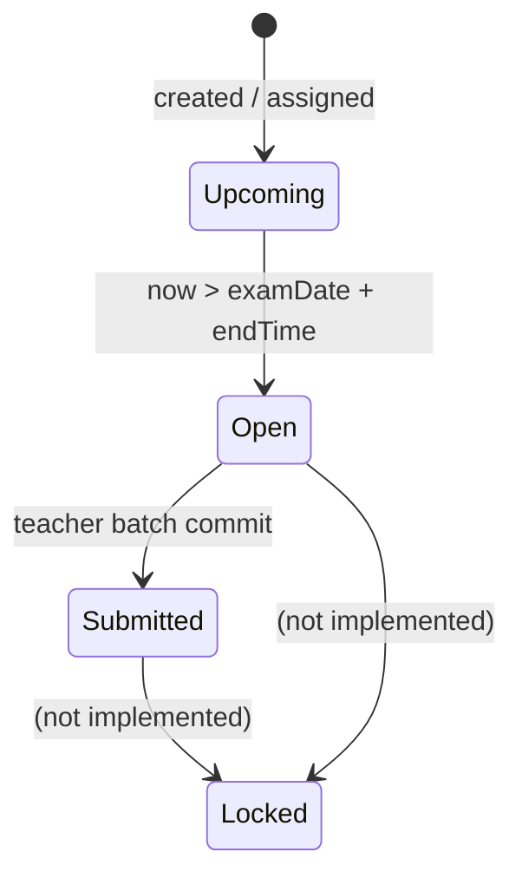
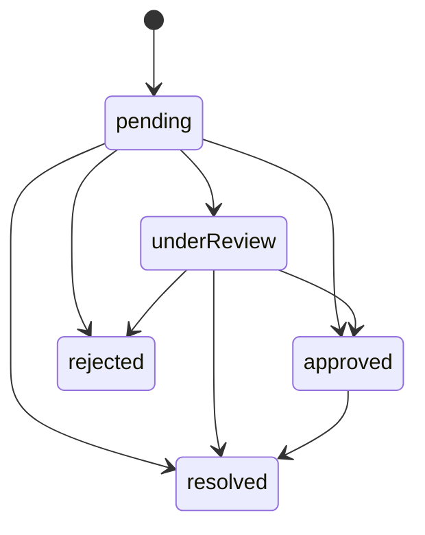

# 06 — Business Rules

> This is the rulebook the rewrite must preserve, rationalise, or consciously change. Every formula is quoted from the current code.

---

## 1. Roles and permissions

### 1.1 Current role model

There are **three separate role systems** in the app:

| System | Values | Used for |
| :--- | :--- | :--- |
| `UserRole` | `teacher`, `admin` | Runtime UI switch. |
| `TeacherModel.role` | `admin`, `teacher` | Firestore rules (`teachers.role`). |
| `StaffModel.accessLevel` | `SuperAdmin`, `SubAdmin`, `TeacherApp`, `NoAccess` | Admin login, staff hub, UI gating. |

The code does not reconcile them. For the rewrite, pick one authorization model.

### 1.2 Effective current permissions

| Capability | SuperAdmin | SubAdmin | TeacherApp | NoAccess | Teacher (UI identity) |
| :--- | :---: | :---: | :---: | :---: | :---: |
| Admin console | ✅ | ✅ | ❌ | ❌ | Via role switch |
| Staff hub / RBAC | ✅ | ❌ (hidden) | ❌ | ❌ | ❌ |
| Principal vault | ✅ | ❌ (hidden) | ❌ | ❌ | ❌ |
| In-app grid | ✅ | ✅ first 7 datasets | ❌ | ❌ | ❌ |
| Bulk import | ✅ all 14 | ✅ first 7 blueprints | ❌ | ❌ | ❌ |
| Teacher workspace | ✅ | ✅ | ✅ | ❌ | ✅ |
| Attendance edit | ✅ | ✅ | ✅ | ❌ | ✅ (all classes) |
| Marks entry | ✅ | ✅ | ✅ | ❌ | ✅ (all exams) |

### 1.3 Intended permission rules from the product notes

- Admin: global CRUD.
- Teacher: scope-locked to records where `timetables.teacher_id == current_user_id`.
- Teacher may create/update marks and attendance only for assigned classes.
- Only admins can delete historical test records.
- Class teacher (or designated incharge) may take roll-call.
- SuperAdmin only can alter staff roles and read the confidential vault.

### 1.4 Actual enforcement gaps

- Admin login checks email only, not password.
- Teacher app has no login.
- Teacher screens do not filter all writes by assignment; e.g. attendance accepts any class.
- Class-incharge gate exists in `AttendanceController` but not in the teacher attendance screen.
- Vault PIN is not validated.
- Sidebar hiding is client-side and bypassable.
- Firestore rules cover only six collections and use a different role source.

**Rewrite rule:** authorization must be enforced by the API/database using the same role + assignment data the UI displays.

---

## 2. Attendance

### 2.1 Daily status model

| Status | Counts as conducted | Counts as attended | Notes |
| :--- | :---: | :---: | :--- |
| Present | ✅ | ✅ 1.0 | Default. |
| Absent | ✅ | ❌ 0 | Requires reason in teacher UI. |
| Late | ✅ | 🟡 0.5 | Monthly formula. |
| Excused | ✅ | ❌ 0 | Not counted as present. |

### 2.2 Daily batch record

`AttendanceRecordModel.create` computes:

```text
total   = number of student items
present = count(status == Present)
absent  = count(status == Absent)
late    = count(status == Late)
percent = present / total * 100
```

**Issue:** `Excused` is neither present, absent, nor late, so `present + absent + late` can be less than `total`, and the percentage ignores excused students. A class with many excused students can show a misleadingly high rate.

### 2.3 Monthly summary (sheet service)

```text
working_days = days_present + days_absent + days_late + days_excused
attendance_percentage = (days_present + 0.5 * days_late) / working_days * 100
```

Rounded to 2 decimals, clamped 0–100.
`absent_dates_list` = comma-separated absent dates.

Fallback if no logs: `working_days = 22`; roster defaults are generated.

### 2.4 Monthly summary (MockDatabase)

Same intent, different implementation:

```text
workingDays = present + absent + late + excused
effectiveConducted = workingDays > 0 ? workingDays : 22
effectiveAttended = workingDays > 0 ? present + round(0.5 * late) : round(22 * student.attendanceRate)
attendancePercentage = effectiveAttended / effectiveConducted * 100
```

`daysPresent` is stored as **effectiveAttended**, not the raw present count, so the UI label “Present” can include half-late rounding.

### 2.5 Cumulative attendance risk tiers

`StudentAttendanceSummaryModel`:

| Tier | Rule | Label |
| :--- | :--- | :--- |
| Optimal | `>= 75%` | Optimal (≥75%) |
| Moderate risk | `60% – 74.99%` | Moderate Risk (60-74%) |
| Critical risk | `< 60%` | Critical Risk (<60%) |

### 2.6 Admin attendance matrix

- Daily stats: total enrolled, present, absent, late, overall percentage `present / enrolled * 100`.
- Class status: submitted true when an in-memory/firestore record exists; otherwise fallback statuses.
- Absent roster includes absent + late students with parent phone.

### 2.7 Roll-call permissions (intended)

- Default incharge = teacher of Period 1 for that class on the current day.
- Admin may override with `incharge_staff_id`.
- Only the incharge (or a global admin) may submit.
- Multiple teachers can hand over between periods; no file lock.

**Actual:** `MockDatabase.isStaffIncharge(staffId, section)`:

1. If a `ClassInchargeModel` exists, compare `inchargeStaffId`.
2. Otherwise compare `getPeriod1TeacherForClass(section)`.
3. `getPeriod1TeacherForClass` scans timetable for `periodNumber == 1`; if none, uses the incharge default; if none, `STAFF-01`.

The teacher attendance screen does not call this.

---

## 3. Marks and assessments

### 3.1 Assessment categories

| Category | Enum | Mandated by | Typical max |
| :--- | :--- | :--- | :--- |
| Class Test | `classTest` | Teacher | 25–50 |
| CA-1 | `ca1` | Teacher | 50 |
| CA-2 | `ca2` | Teacher | 50 |
| Mid-Term | `midTerm` | Principal/Admin | 100 |
| End-Term | `endTerm` | Principal/Admin | 100 |

### 3.2 Score calculations

`TestRecord`:

```text
percentage = marksObtained / maxMarks * 100
isFailing  = percentage < 35
classAveragePercentage = mean(studentScores) / maxMarks * 100
isClassAtRisk = classAveragePercentage < 50
passCount = count(score / maxMarks >= 0.40)
failCount = count(score / maxMarks < 0.40)
```

**Inconsistency:** pass/fail threshold is 35% for an individual in `isFailing`/`isPassed`, but 40% in `passCount`/`failCount`.

`TestRecordModel`:

```text
scorePercentage = marksObtained / maxMarks * 100
isPassed = scorePercentage >= 35
letterGrade:
  A+ >= 90, A >= 80, B >= 70, C >= 60, D >= 50, E >= 35, F < 35
```

### 3.3 Risk rules

| Scope | Rule | Source |
| :--- | :--- | :--- |
| Student | Average recent scores `< 35%` **or** latest score `< 35%` (with ≥2 scores) | `Student.isAtRisk` |
| Student | Any term score `>= 35` fails; cumulative `< 35` | `StudentResultRow.isAtRisk` |
| Class | Class average `< 50%` | `TestRecord.isClassAtRisk` |
| Attendance | `< 60%` critical, `60–74.99%` moderate, `>=75%` optimal | `StudentAttendanceSummaryModel` |

The product notes say “class average below 50% or individual below 35% across three sequential tests”. The code flags a student as soon as one score is below 35 (or average below 35), not necessarily three consecutive tests.

### 3.4 Exam lifecycle



- `effectiveStatus` computes `Open` dynamically; the stored status remains `Upcoming` until submission.
- A submitted exam cannot be reopened in the UI.
- There is no deadline enforcement, even though `marksSubmissionDeadline` exists.
- There is no edit window; the “lock” is only a label.

### 3.5 Marks entry validation

Current:

- Missing/non-numeric input → 0.
- Values above `maxMarks` are clamped in the text field.
- Negative values are not explicitly blocked (a negative parse would be accepted).
- No warning for missing scores; every student is committed.
- `TestRecordModel.create` clamps marks to `0..maxMarks` and computes pass.

**Rewrite requirements:**

- Reject negative or blank values.
- Allow draft + submit.
- Show a confirmation summary.
- Record who entered/changed each score.
- Enforce a deadline/grace period.
- Allow controlled corrections with audit.

### 3.6 Result matrix

`ClassResultMatrix.build` joins students and test records by section and optional subject, then maps by `examCategory`:

- `ca1`, `ca2`, `midTerm`, `endTerm` → row columns.
- Total = sum of marks; max = sum of max marks (default 100 if none).
- Cumulative percentage = total / total max * 100.
- At-risk if any term below 35 or cumulative below 35.
- Grade A+..F by the same thresholds as `TestRecordModel`.

This matrix is implemented but not rendered in the current admin UI.

---

## 4. Syllabus

### 4.1 Chapter progress (teacher UI)

- `ChapterProgress.status` ∈ `pending`, `in_progress`, `completed`.
- Tap cycles status.
- `SubjectModel.completionPercentage = completedChapters / totalChapters * 100`.
- `inProgressChapters` counts only `in_progress`.
- “Left” in the UI = total − completed − in_progress.

### 4.2 Topic completion (admin/Excel)

- `SyllabusTopic.completionStatus` bool.
- Admin grid toggle flips the bool.
- Teacher UI toggles chapter status, not topic bool.

These two models are not synchronised.

### 4.3 Admin velocity

The intended formula:

```text
Syllabus Progress Ratio = completed topics / total required topics * 100
```

The current admin dashboard velocity panel is static; no formula is applied.

### 4.4 Deadlines

No syllabus deadlines exist in the data model, despite “delay badge” claims. There is no expected completion date, no velocity calculation, and no alert when a subject lags.

---

## 5. Timetable and conflicts

### 5.1 Parsing rules

- Day: 1 = Monday … 5 = Friday (6/7 tolerated in some parsers).
- Time: `HH:mm:ss`; start must be before end (not actually validated in all paths).
- Period number: positive integer.
- Room: free text.

### 5.2 Conflict guards (intended and partly implemented)

`MockDatabase.ingestTimetableMaster` checks, **within the uploaded file only**:

- Same day + same start time + same teacher → abort.
- Same day + same start time + same class → abort.

It does **not** check:

- Existing database rows.
- Overlapping intervals that do not have identical start times.
- Room double-booking.
- Teacher/class conflicts with different start times but overlapping ranges.

`ExcelMasterService` does not run conflict checks at all before committing; it delegates to `MockDatabase.ingestTimetableMaster` only if that sheet is committed.

### 5.3 Correct overlap rule for the rewrite

Two periods overlap when:

```text
same day AND startA < endB AND startB < endA
```

Reject if the same teacher, class, or room overlaps. Use a database exclusion constraint or a serializable transaction.

### 5.4 Incharge default

- Period 1 teacher = default attendance taker.
- Admin override stored in `class_incharge_master`.
- `academic_year` is stored but not used in resolution.

---

## 6. Staff attendance

### 6.1 Statuses

`Present`, `Absent`, `Half-Day`, `On Leave`.

### 6.2 Record ID

```text
SA_{YYYYMMDD}_{STAFF_ID}
```

Example: `SA_20260830_STAFF-01`.

### 6.3 Operations

- Check-in sets `check_in_time` and status Present.
- Check-out sets `check_out_time`.
- Leave sets status On Leave and `leave_reason`.
- If no record exists for a date, `MockDatabase.getStaffAttendanceByDate` seeds all staff as Absent.
- Presence rate = present / total staff * 100; present includes any checked-in record.

### 6.4 Gaps

- No geofence/biometric/device verification.
- Half-Day is defined but not reachable from the UI.
- No late calculation, shift schedule, or overtime.
- No link to leave approval (approving an RMS leave does not change staff attendance).

---

## 7. RMS classification

`RmsTicket.classifyText(text, {userToggledPrivate})` checks in order:

1. **Confidential** if:
   - user toggled private, or
   - text contains `confidential`, `private`, `personal`, `harassment`, `complaint`.
2. **Staff leave** if:
   - `leave`, `sick`, `absent`, `casual leave`, `medical`, `emergency`.
3. **Maintenance** if:
   - `broken`, `projector`, `repair`, `ac`, `fan`, `light`, `bench`, `wi-fi`, `wifi`, `bulb`, `desk`.
4. Otherwise **general operational**.

Classification labels:

| Category group | Label |
| :--- | :--- |
| staffLeave, leaveRequest | STAFF LEAVE REQUEST |
| maintenance, facilityGearMalfunction | FACILITY MAINTENANCE |
| confidential | CONFIDENTIAL CHANNEL |
| generalOperational, operationalPriority, studentDisciplinary, academicResource | OPERATIONAL NOTE |

**Gaps**

- Keyword-only, English-only, no NLP model.
- `ac` matches substrings inside words (e.g. “practice” contains “ac”?) — `contains('ac')` can produce false positives.
- Emergency is classified as leave before maintenance, so “emergency electrical repair” becomes leave.
- No severity extraction, room extraction (except a fallback to the teacher's current period room), or assignee.
- No duplicate detection.
- No SLA or status transition validation (any status can jump to any other).

### 7.1 Status workflow



The UI only offers approve/reject for leave and resolve/assign for maintenance. No transition guard exists; `updateRmsTicketStatus` accepts any status.

---

## 8. Announcements

### 8.1 Priority

`Normal`, `Important`, `Urgent`, `Emergency`.

- Urgent/Emergency auto-pin on creation.
- `requiresAlertHeader` = Emergency || Urgent || pinned.
- Dashboard banner shows the first alert-header notice.

### 8.2 Audience

`All`, `TeachersOnly`, `StudentsOnly`, `Class10`, `Class9`.

Teacher feed filters to `All`, `TeachersOnly`, and legacy string variants (`Teachers`, `Teachers Only`). It does **not** include `Class10`/`Class9`, so a Grade 10-only notice is invisible to teachers.

### 8.3 Relative time

- `< 60 s` → “Just now”
- `< 60 min` → “Nm ago”
- `< 24 h` → “Nh ago”
- 1 day → “Yesterday”
- `< 7 days` → “Nd ago”
- else `D/M/YYYY`

### 8.4 Push notification

Only a `print` statement. No FCM token registration, no server key, no delivery.

---

## 9. Excel ingestion rules

### 9.1 Student roster

- Required fields: `student_id`, `name`, `class_id_section` (depending on parser).
- Duplicate guard:
  - Master ingest aborts on duplicate name within the same section.
  - Excel master parser only warns on duplicate student ID or roll.
- Phone normalization: intended E.164; actual code only trims and does not validate most numbers.
- Upsert: matching `student_id` or name+section updates; otherwise inserts.

### 9.2 Timetable

- Duplicate/overlap guard as above (same start time only, file-only).
- Teacher email → ID resolution is **not implemented** in `MockDatabase.ingestTimetableMaster`; it stores the raw `teacher_id`/`teacher_email`.
- `ExcelIngestionService` never ingests timetables.

### 9.3 Marks

- `marks_obtained` parsed as double; invalid → 0.
- `max_marks` invalid → 50.
- Student lookup by name + section, fallback to the first student (dangerous).
- Creates `ca1` records with title `{Subject} Assessment` if no existing test ID.
- No range validation.

### 9.4 Syllabus

- `completion_status` accepted as TRUE/1/Completed.
- Existing item by `syllabus_item_id` is updated; otherwise inserted.
- Chapter title is generated as `Chapter N` if not supplied.

### 9.5 Staff

- Required: name, email; email must contain `@`.
- Duplicate email within the batch is rejected as an error row.
- Duplicate staff ID/email updates the existing record.
- No validation of access level or staff type values.

### 9.6 Exams

- Defaults: category `ca1`, date today, 09:00–12:00, 50 marks, active teacher.
- No validation that the class/subject/teacher exist.
- Upsert by `exam_id`.

### 9.7 RMS import

- Every imported ticket gets `teacherId = tch_imported`, email `staff@school.edu`.
- Category is leave if tag contains “leave”, otherwise maintenance.
- No status parsing beyond default pending.

### 9.8 Attendance import

- `status` string matched by substring: contains “absent” → Absent, contains “late” → Late, else Present.
- Conducted/attended default 60/85% if missing.
- No duplicate-day handling.

---

## 10. Import/export file paths

- Web: browser download.
- Desktop/mobile IO: `getDownloadsDirectory()` if available, else documents directory.
- UI copy claims `C:\SchoolManagement\Exports\...`; the exporter does not create that exact path unless the downloads directory is that path.
- File names:
  - `nawaz_school_master_database.xlsx`
  - `students_master.csv`
  - `marks_master.csv`
  - `timetable_master.csv`
  - `syllabus_master.csv`
  - `attendance_master.csv`
  - `rms_records.csv`
  - `exam_schedules.csv`
  - `staff_access_master.csv`
  - `announcements.csv`

---

## 11. Rule inconsistencies to resolve before rewriting

| # | Inconsistency | Impact | Recommended rule |
| :--- | :--- | :--- | :--- |
| R-01 | Pass threshold 35% vs 40% | Different pass counts in different screens | Choose one (product says 35% risk, 40% pass; document both explicitly). |
| R-02 | Student risk “any one test” vs “three consecutive” | Over-flagging | Use configurable consecutive-test rule. |
| R-03 | Syllabus has bool topics and enum chapters | Teacher/admin see different progress | Use one topic-status enum; chapter progress derived. |
| R-04 | Two exam models | Compile failure | One canonical exam model. |
| R-05 | Attendance excused ignored in percentage | Misleading rates | Define whether excused counts in denominator; usually yes, not in numerator. |
| R-06 | Class attendance one doc per section/day vs per session | Cannot represent morning/afternoon/period | Model sessions explicitly. |
| R-07 | Late = 0.5 vs 1.0 | Different reports | Make policy explicit per school. |
| R-08 | Teacher/Staff/Faculty identities disconnected | Wrong scoping | One staff identity; link teacher auth to staff. |
| R-09 | Firestore rules role source vs app role source | Writes denied or insecure | One role claim in auth token. |
| R-10 | Audience filter excludes class-specific notices | Teachers miss notices | Resolve audience against the user's class assignments. |
| R-11 | Incharge not enforced in teacher UI | Unauthorized roll-call | Enforce in API and UI. |
| R-12 | “Lock” is cosmetic | Scores editable after submission | Enforce deadline/status on the server. |
| R-13 | Excel import not transactional | Partial imports | All-or-nothing transaction, or explicit partial-commit report. |
| R-14 | Time zones not modelled | Exam unlock/attendance date can be wrong | Store UTC + institution timezone. |
| R-15 | No academic year on most records | Historical data mixes years | Add `academic_year_id` and archive per year. |
