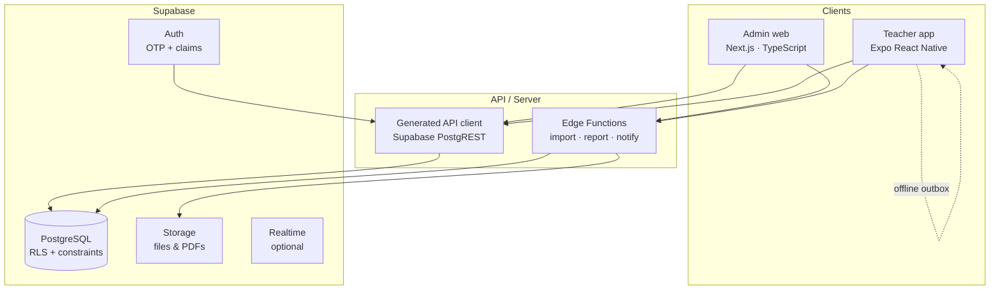
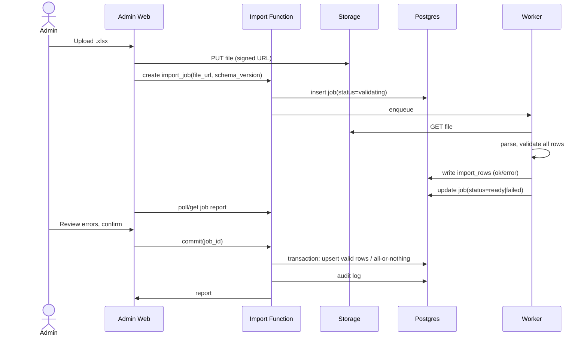

# 10 — Rewrite Guide

> **Goal:** rebuild the same two products with fewer moving parts, real persistence, enforced permissions, and a codebase a small team can maintain.

---

## 1. Recommended target stack

### 1.1 Decision summary

| Layer | Recommendation | Why |
| :--- | :--- | :--- |
| Database | **PostgreSQL** (Supabase-hosted or managed) | Relational school data, joins, constraints, transactions, mature tooling. |
| Auth | **Supabase Auth** (email OTP / magic link) + custom claims | No password storage, invite flow, admin MFA option. |
| API | **Supabase PostgREST + Edge Functions** for imports/reports; optionally a thin Node service | CRUD from generated client; heavy jobs in functions. |
| Admin client | **Next.js + TypeScript + React** | Desktop-first web app, excellent tables/forms, fast iteration, easy deployment. |
| Teacher client | **Expo React Native + TypeScript** (or Flutter if the team insists) | One language across the stack; native share/files/offline; phone-first. |
| Shared domain | **`packages/domain`**: TypeScript types + Zod schemas + generated DB types | One schema, one validation layer, no duplicate models. |
| Offline | **Expo SQLite / WatermelonDB + outbox** | Real offline roll-call/marks with sync. |
| Files | **Supabase Storage** | Roster imports, announcement images, generated PDFs. |
| PDF | Server-side (React-PDF / Puppeteer) or `pdf-lib` | Real report generation. |
| Notifications | **FCM/APNs** via Expo or OneSignal; optional WhatsApp Cloud API | Real delivery, opt-in. |
| Tests | **Vitest** (domain), **Playwright** (admin), **Detox/Maestro** (teacher), **pgTAP** (RLS) | Confidence at every layer. |
| CI/CD | GitHub Actions; Vercel for admin; EAS for mobile; Supabase migrations | Repeatable deploys. |

### 1.2 If the team must stay on Flutter

Keep Flutter for the teacher app (it is already strong) but move the admin to a web stack (Next.js) and the backend to Postgres. This removes the “desktop admin in Flutter” complexity while preserving the phone UX. Use:

- `flutter_riverpod` or `bloc` for state.
- `drift` for offline SQLite.
- `freezed` + `json_serializable` for models.
- `go_router` for navigation.
- One generated API client from OpenAPI.

### 1.3 If a native Windows admin is mandatory

Use **Tauri** (Rust + web UI) instead of Electron: smaller, faster, secure, and the admin UI can still be React/TypeScript. A browser-based Next.js admin with a PWA is simpler unless offline desktop access or local file-system integration is a hard requirement.

### 1.4 What not to do

- Do not keep a single app with a runtime role toggle.
- Do not keep a global mutable singleton as the database.
- Do not keep duplicate models “for compatibility”.
- Do not build custom auth or store passwords.
- Do not store school data only in Excel files.
- Do not call a snackbar a PDF/share/notification.
- Do not implement RBAC by hiding UI.

---

## 2. Target architecture



### 2.1 Module boundaries

| Module | Owns | Key tables |
| :--- | :--- | :--- |
| Identity | Users, staff, roles, invitations | `staff`, `auth.users`, `staff_roles` |
| Academics | Years, classes, subjects, offerings, timetable | `academic_years`, `classes`, `subjects`, `subject_offerings`, `timetable_periods` |
| Students | Roster, guardians | `students`, `guardians` |
| Attendance | Sessions, entries, summaries | `attendance_sessions`, `attendance_entries` |
| Assessment | Exams, scores, result views | `exams`, `test_records` |
| Curriculum | Syllabus items and progress | `syllabus_items` |
| Operations | RMS tickets, leave, maintenance | `rms_tickets`, `rms_comments` |
| Communications | Announcements, audiences, deliveries | `announcements`, `announcement_audiences` |
| Reporting | PDF jobs, exports | `report_jobs` |
| Audit | Who changed what | `audit_events` |
| Import | Jobs, row errors, versions | `import_jobs`, `import_rows` |

Each module should have its own service/repository in the backend and its own folder in the clients. No module reaches into another's tables directly; use views/functions for cross-module reads.

### 2.2 Permissions model

Use **one** role source:

```text
staff.access_level: SUPER_ADMIN | SUB_ADMIN | TEACHER | NO_ACCESS
```

Optionally add granular permission flags later:

```text
can_manage_staff, can_manage_rbac, can_view_vault,
can_import, can_manage_exams, can_take_attendance
```

Enforcement layers:

1. **Postgres RLS** on every table.
2. **API checks** in edge functions for bulk/report actions.
3. **UI** hides/blocks actions for clarity, never as the only control.

Teacher scoping:

```sql
-- teacher can read students in classes where they teach or are incharge
exists (
  select 1
  from subject_offerings so
  join classes c on c.id = so.class_id
  where so.teacher_staff_id = auth.uid()
    and c.id = students.class_id
)
or exists (
  select 1 from class_incharges ci
  where ci.class_id = students.class_id and ci.active_staff_id = auth.uid()
)
```

Use `auth.uid()` mapped to `staff.id` (or a `staff.auth_user_id` column).

### 2.3 Teacher invitation flow

1. Admin creates staff member with email + access level `TEACHER`.
2. Backend sends a Supabase invite / magic link.
3. First login sets password or uses OTP.
4. Profile is linked to `staff.auth_user_id`.
5. Teacher sees only their assigned classes/subjects.

### 2.4 Admin login

- Email OTP or SSO (Google/Microsoft) for staff with `SUPER_ADMIN`/`SUB_ADMIN`.
- Require MFA for `SUPER_ADMIN`.
- Session expiry and refresh handled by Supabase.
- No shared demo credentials in production.

### 2.5 Import pipeline



Rules:

- Never mutate live tables during validation.
- Store row-level errors for download.
- Commit in a transaction or explicitly label partial import.
- Keep a versioned template with a `schema_version` cell/sheet.
- Support legacy 8/9-sheet files via adapters.
- Enforce idempotency with stable natural keys.

### 2.6 Offline-first teacher

Use an outbox:

```text
local tables: classes, students, timetable, syllabus, exams, cached marks
outbox: id, entity, operation, payload, created_at, attempts, last_error
```

- Read from local cache immediately.
- Write locally + enqueue.
- Sync when online; server is authoritative.
- Conflict policy:
  - Attendance: last-write-wins per session, but keep an audit entry.
  - Marks: server rejects if exam locked; keep local draft and show conflict.
- Show a clear “pending sync” badge and retry/error details.

### 2.7 Reporting and sharing

- Generate PDFs server-side from a versioned template.
- Store in Supabase Storage; return a signed URL.
- Teacher app opens the native share sheet with the PDF.
- WhatsApp: use the OS share sheet first; optionally `wa.me` deep link with text.
- Never claim delivery without a provider response or user confirmation.

### 2.8 Notifications

- Store device tokens per staff user.
- Send via FCM/APNs (Expo push) or a provider.
- Respect opt-out and quiet hours.
- Log delivery attempts.
- For emergency announcements, consider SMS/WhatsApp as a separate, explicitly configured channel.

---

## 3. Database schema (starting point)

```sql
-- Identity
create table staff (
  id uuid primary key default gen_random_uuid(),
  auth_user_id uuid unique references auth.users(id),
  staff_code text unique not null,
  name text not null,
  email citext unique not null,
  phone text,
  staff_type text not null,
  department text,
  access_level text not null check (access_level in ('SUPER_ADMIN','SUB_ADMIN','TEACHER','NO_ACCESS')),
  is_active boolean not null default true,
  joined_on date,
  created_at timestamptz not null default now(),
  updated_at timestamptz not null default now()
);

create table academic_years (
  id uuid primary key default gen_random_uuid(),
  label text unique not null,          -- 2026-2027
  starts_on date not null,
  ends_on date not null,
  is_active boolean not null default false
);

create table classes (
  id uuid primary key default gen_random_uuid(),
  academic_year_id uuid not null references academic_years(id),
  grade_level int not null,
  section text not null,
  display_name text not null,
  class_teacher_staff_id uuid references staff(id),
  unique (academic_year_id, grade_level, section)
);

create table students (
  id uuid primary key default gen_random_uuid(),
  academic_year_id uuid not null references academic_years(id),
  student_code text not null,
  roll_number text not null,
  name text not null,
  class_id uuid not null references classes(id),
  parent_phone text,
  date_of_birth date,
  address text,
  status text not null default 'ACTIVE',
  created_at timestamptz not null default now(),
  unique (academic_year_id, student_code),
  unique (class_id, roll_number)
);

create table subjects (
  id uuid primary key default gen_random_uuid(),
  code text unique not null,           -- MATH-10
  name text not null,
  grade_level int not null
);

create table subject_offerings (
  id uuid primary key default gen_random_uuid(),
  subject_id uuid not null references subjects(id),
  class_id uuid not null references classes(id),
  teacher_staff_id uuid references staff(id),
  unique (subject_id, class_id)
);

create table timetable_periods (
  id uuid primary key default gen_random_uuid(),
  class_id uuid not null references classes(id),
  subject_offering_id uuid not null references subject_offerings(id),
  teacher_staff_id uuid not null references staff(id),
  day_of_week int not null check (day_of_week between 1 and 7),
  period_number int not null check (period_number > 0),
  starts_at time not null,
  ends_at time not null,
  room text,
  check (starts_at < ends_at)
);

create table syllabus_items (
  id uuid primary key default gen_random_uuid(),
  subject_offering_id uuid not null references subject_offerings(id),
  chapter_number int not null,
  chapter_title text not null,
  topic_title text not null,
  status text not null default 'PENDING' check (status in ('PENDING','IN_PROGRESS','COMPLETED')),
  completed_at timestamptz,
  unique (subject_offerings_id, chapter_number, topic_title)
);

create table exams (
  id uuid primary key default gen_random_uuid(),
  class_id uuid not null references classes(id),
  subject_offering_id uuid not null references subject_offerings(id),
  category text not null check (category in ('CA1','CA2','MID_TERM','END_TERM','CLASS_TEST')),
  title text not null,
  exam_date date not null,
  starts_at time not null,
  ends_at time not null,
  max_marks numeric(6,2) not null check (max_marks > 0),
  assigned_teacher_staff_id uuid references staff(id),
  marks_status text not null default 'UPCOMING'
    check (marks_status in ('UPCOMING','OPEN','SUBMITTED','LOCKED')),
  submission_deadline timestamptz,
  created_at timestamptz not null default now()
);

create table test_records (
  id uuid primary key default gen_random_uuid(),
  exam_id uuid not null references exams(id) on delete cascade,
  student_id uuid not null references students(id) on delete cascade,
  marks_obtained numeric(6,2) not null check (marks_obtained >= 0),
  max_marks numeric(6,2) not null check (max_marks > 0),
  entered_by_staff_id uuid not null references staff(id),
  entered_at timestamptz not null default now(),
  updated_at timestamptz not null default now(),
  unique (exam_id, student_id),
  check (marks_obtained <= max_marks)
);

create table attendance_sessions (
  id uuid primary key default gen_random_uuid(),
  class_id uuid not null references classes(id),
  session_date date not null,
  session_type text not null check (session_type in ('MORNING','AFTERNOON','FULL_DAY','PERIOD')),
  period_number int,
  taken_by_staff_id uuid references staff(id),
  submitted_at timestamptz,
  unique (class_id, session_date, session_type, period_number)
);

create table attendance_entries (
  id uuid primary key default gen_random_uuid(),
  session_id uuid not null references attendance_sessions(id) on delete cascade,
  student_id uuid not null references students(id) on delete cascade,
  status text not null check (status in ('PRESENT','ABSENT','LATE','EXCUSED')),
  remarks text,
  updated_at timestamptz not null default now(),
  unique (session_id, student_id)
);

create table class_incharges (
  id uuid primary key default gen_random_uuid(),
  class_id uuid not null references classes(id),
  academic_year_id uuid not null references academic_years(id),
  default_staff_id uuid references staff(id),
  active_staff_id uuid not null references staff(id),
  created_at timestamptz not null default now(),
  unique (class_id, academic_year_id)
);

create table rms_tickets (
  id uuid primary key default gen_random_uuid(),
  ticket_no text unique not null,
  sender_staff_id uuid not null references staff(id),
  category text not null,
  subject text not null,
  body text not null,
  room text,
  priority text not null default 'MEDIUM',
  is_confidential boolean not null default false,
  status text not null default 'PENDING'
    check (status in ('PENDING','UNDER_REVIEW','APPROVED','REJECTED','RESOLVED')),
  principal_note text,
  created_at timestamptz not null default now(),
  resolved_at timestamptz
);

create table announcements (
  id uuid primary key default gen_random_uuid(),
  title text not null,
  body text not null,
  importance text not null check (importance in ('NORMAL','IMPORTANT','URGENT','EMERGENCY')),
  image_url text,
  is_pinned boolean not null default false,
  publisher_staff_id uuid not null references staff(id),
  published_at timestamptz not null default now(),
  expires_at timestamptz
);

create table announcement_audiences (
  announcement_id uuid not null references announcements(id) on delete cascade,
  audience_type text not null check (audience_type in ('ALL','TEACHERS','STUDENTS','CLASS')),
  class_id uuid references classes(id),
  primary key (announcement_id, audience_type, class_id)
);
```

Add:

- `staff_attendance` table.
- `report_jobs`, `import_jobs`, `import_rows`.
- `audit_events`.
- `notification_tokens`, `notification_deliveries`.
- `attachments`.

Use `citext`, `pgcrypto`, `timestamptz`, and `numeric` for marks. Add indexes for the queries in [02 — Architecture](02-architecture.md) and [05 — Data Model](05-data-model.md).

---

## 4. API contract (conceptual)

Use generated REST/RPC from Postgres or tRPC/OpenAPI. Example endpoints:

```text
GET    /me
GET    /classes
GET    /classes/:id/students
GET    /classes/:id/timetable?date=
GET    /teachers/:id/schedule?from=&to=
GET    /subjects?classId=
GET    /syllabus?offeringId=
PATCH  /syllabus/:itemId        { status }
GET    /exams?teacherId=&classId=&status=
POST   /exams
POST   /exams/:id/records       { records: [{ studentId, marks }] }
POST   /exams/:id/submit
GET    /attendance?classId=&date=&session=
PUT    /attendance/:sessionId   { entries: [{ studentId, status, remarks }] }
GET    /analytics/overview
GET    /analytics/subject?classId=&subjectId=
POST   /imports                 { fileUrl, schemaVersion }
GET    /imports/:id
POST   /imports/:id/commit
POST   /reports/executive       { termId }
GET    /reports/:jobId
GET    /announcements?audience=
POST   /announcements
PATCH  /announcements/:id/pin
DELETE /announcements/:id
GET    /rms?status=&category=
POST   /rms
PATCH  /rms/:id/status
```

Every mutation returns the updated resource and an audit ID. Every list supports pagination, sorting, and filters.

---

## 5. Migration plan

### Phase 0 — Freeze and inventory (1–2 days)

- Tag the current repo as `legacy-prototype`.
- Export the seed data as JSON fixtures.
- List all screens/use cases (this documentation set).
- Decide which features are in scope for v1.
- Do not fix legacy code except for blockers needed to run demos.

### Phase 1 — Foundations (1–2 weeks)

- Create monorepo: `apps/admin`, `apps/teacher`, `packages/domain`, `packages/api-client`, `supabase/`.
- Set up Supabase project, migrations, RLS, auth.
- Create the canonical schema and seed a small demo school.
- Set up CI: lint, typecheck, unit tests, migration tests.
- Set up environments: local, staging, production.

### Phase 2 — Teacher MVP (2–3 weeks)

1. Login/invite.
2. Profile + assigned classes.
3. Timetable (real today/week).
4. Attendance (offline outbox).
5. Syllabus tick.
6. Exams/marks entry.
7. Notices.
8. RMS create/list.
9. Student report (PDF + share).

Ship to a pilot group of teachers.

### Phase 3 — Admin MVP (3–4 weeks)

1. Admin login + RBAC.
2. Dashboard with real aggregates.
3. Staff directory + invitations.
4. Classes/students CRUD.
5. Subject offerings + timetable.
6. Exam assignment.
7. Attendance oversight.
8. Announcements.
9. RMS queues + vault.
10. CSV/Excel import v1 (students, timetable, marks, staff).

### Phase 4 — Bulk import and reports (2–3 weeks)

- Full 14-sheet import with validation report and transaction.
- Legacy 8/9-sheet adapter.
- PDF executive report.
- CSV exports per dataset.
- Import history/rollback.

### Phase 5 — Parity and cutover (2 weeks)

- Side-by-side comparison on real school data.
- Data migration rehearsal.
- Train admins/teachers.
- Read-only legacy period.
- Go-live with rollback plan.

### Phase 6 — Delete the prototype

- Archive the Flutter repo.
- Remove demo credentials and seed data from production.
- Keep this documentation as the historical reference.

---

## 6. Acceptance criteria for v1

### Security

- [ ] Admin and teacher authenticate through the provider.
- [ ] Password/MFA policy enforced for admins.
- [ ] Every table has RLS.
- [ ] Teacher can access only assigned classes/subjects.
- [ ] SubAdmin cannot alter RBAC or open the vault.
- [ ] Vault requires re-auth and is audited.
- [ ] No secrets/demo passwords in the client bundle.

### Data

- [ ] All edits persist after reload.
- [ ] Unique constraints on student code, roll per class, staff code/email, exam+student score, attendance session+student.
- [ ] Foreign keys for every relationship.
- [ ] `academic_year_id` on all year-scoped data.
- [ ] Timestamps in UTC; display in institution timezone.
- [ ] Soft delete/audit for marks, attendance, staff, RBAC, vault.

### Workflows

- [ ] Teacher can take roll-call offline and sync.
- [ ] Teacher can enter marks only for open exams and assigned classes.
- [ ] Marks lock after the deadline; corrections require an admin and are audited.
- [ ] Admin can import a workbook atomically with a row-level error report.
- [ ] Admin can create a student, class, subject offering, timetable period, exam, and announcement.
- [ ] Class incharge default/override works and is enforced.
- [ ] Notices respect audience, including class-specific notices.
- [ ] RMS request reaches the right queue; status changes are visible to the sender.
- [ ] Executive report produces a real PDF from live data.

### Quality

- [ ] `flutter analyze`/`tsc --noEmit` and lint pass with zero errors.
- [ ] Unit tests for all formulas.
- [ ] RLS tests for each role.
- [ ] E2E tests for teacher roll-call, marks, admin import, staff RBAC.
- [ ] Accessibility: readable font sizes, keyboard navigation, contrast.
- [ ] Performance: 1,000 students and 50,000 marks remain responsive.

---

## 7. Work-simplification rules for the new codebase

1. **One language, one schema.** TypeScript across clients + generated DB types.
2. **One ID per entity.** UUID PK + human code; never parse meaning from strings.
3. **One status enum per concept.** No `Present` vs `present` vs `P`.
4. **One write path per action.** UI → API → DB → audit.
5. **One source of truth for permissions.** Server claims + RLS.
6. **One template.** Versioned workbook schema with validation.
7. **No silent failures.** Show errors, log them, retry where sensible.
8. **No demo copy in production.** Feature flags for demo data.
9. **No dead code.** Delete unused screens/models; CI forbids warnings-as-errors in app code.
10. **Small modules.** Each domain has a service, repository, tests, and UI folder.
11. **Generated clients.** No hand-written duplicate DTOs.
12. **Migrations only.** No manual DB edits.
13. **Audit by default.** Every sensitive mutation writes an event.
14. **Time zone explicit.** Store UTC, display institution time.
15. **Offline is a feature, not a toggle.** Build the outbox from day one if teachers need it.

---

## 8. Old-to-new mapping

| Legacy concept | New concept |
| :--- | :--- |
| `MockDatabase` | Postgres + repositories |
| `db.students` | `students` table |
| `db.staffList` | `staff` table |
| `db.facultyList` | `staff` filtered by `staff_type = 'TEACHER'` |
| `db.timetable` | `timetable_periods` |
| `db.subjects` | `subjects` + `subject_offerings` + `syllabus_items` |
| `db.syllabus` | `syllabus_items` |
| `db.testRecords` | `test_records` (+ `exams`) |
| `db.examSchedules` | `exams` |
| `db.attendanceSummaries` | derived view over `attendance_entries` |
| `db.dailyAttendanceRecords` | `attendance_sessions` + `attendance_entries` |
| `db.staffAttendanceRecords` | `staff_attendance` |
| `db.classIncharges` | `class_incharges` |
| `db.rmsTickets` | `rms_tickets` |
| `db.announcements` | `announcements` + `announcement_audiences` |
| `MockDatabase.ingest*` | `import_jobs` + validation + bulk upsert |
| `ExcelMasterService.exportMasterWorkbook` | versioned report/export job |
| `AuthService` static checks | Supabase Auth + claims + RLS |
| `AdminStateController` | admin query/store (React Query/Zustand) |
| `AttendanceController` | teacher attendance store + outbox |
| `PercentRing` / Bento tokens | shared design system package |

---

## 9. Risks and mitigations

| Risk | Mitigation |
| :--- | :--- |
| Scope creep from the huge admin surface | Ship teacher MVP + core admin first; defer analytics, vault, audit viewer. |
| Excel files from the school are messy | Robust validators, row-level errors, legacy adapters, dry runs. |
| Teachers have poor connectivity | Offline-first from day one. |
| Admin expects Windows desktop | Confirm requirement; use Tauri or a PWA. |
| Data migration loses history | Rehearse migration; keep legacy read-only; reconcile counts. |
| Permission model changes | Centralize claims; test every role with RLS tests. |
| PDF/WhatsApp expectations | Agree on channels and fallbacks before building. |
| Time zone/date bugs | Store UTC, use institution timezone, test around midnight. |
| Small team | One language, generated code, managed services, no custom infra. |

---

## 10. Definition of done for the rewrite

The rewrite is done when:

1. A teacher can log in, see only their classes, take attendance offline, enter marks for an open exam, tick syllabus progress, read notices, raise an RMS request, and share a real PDF report.
2. An admin can log in with MFA, manage staff and RBAC, import a validated workbook atomically, assign subjects/exams/incharges, see real analytics, approve leave, resolve maintenance, read the vault with re-auth and audit, publish announcements, and generate a real executive PDF.
3. Every edit survives reload and is attributed to a user.
4. All permissions are enforced server-side.
5. CI is green: typecheck, lint, unit, RLS, E2E.
6. The old Flutter prototype is archived, not extended.
